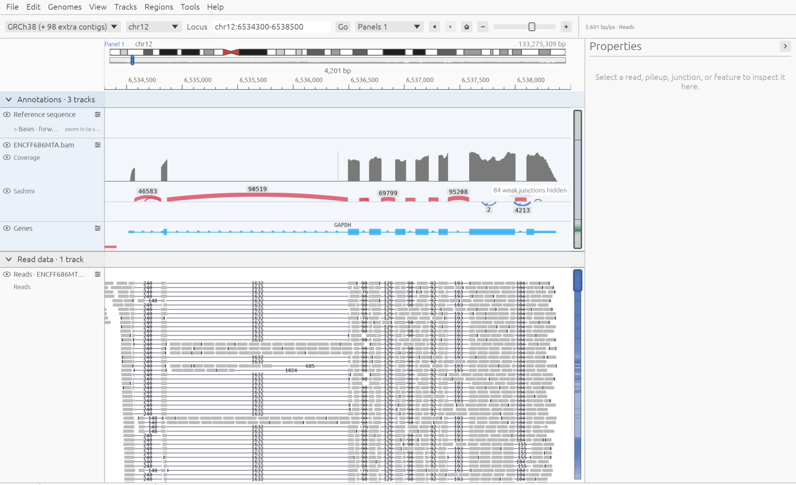

<p align="center"></p>

<h1 align="center">RGV</h1>

<p align="center">
A fast, free genome browser for looking at sequencing data on your own computer.<br>
Open a BAM file and see every read, base and splice junction, instantly.
</p>

<p align="center">
<a href="https://github.com/alexcoulton/rgv/releases/latest"><b>Download</b></a> ·
<a href="docs/USER_GUIDE.md">User guide</a> ·
<a href="docs/FEATURES.md">All features</a> ·
<a href="https://github.com/alexcoulton/rgv/issues">Report a problem</a>
</p>



## What is RGV?

RGV (Rust Genome Viewer) is a desktop app for exploring aligned sequencing data: the reads in a
BAM or CRAM file, laid out against the reference genome. If you have used
[IGV](https://igv.org), it will feel familiar. RGV is written in Rust and draws on the GPU, so it
stays smooth when you pan and zoom through deep coverage or long reads.

It is for anyone who needs to look at reads: checking a variant call, seeing how a gene is
spliced, looking at methylation on long reads, or just making sure an alignment looks right.

> **RGV is early software.** It works well day to day, but expect rough edges and things that
> change between versions. If something looks wrong, please
> [open an issue](https://github.com/alexcoulton/rgv/issues).

## What you can do with it

- **See your reads.** Coverage, every read with its mismatches, insertions, deletions and clipped
  ends, and paired reads joined to their mates.
- **Check variants.** Hover over any base or event to see what it is and how many reads at that
  position share it. Click a read for its full details.
- **Explore splicing.** RNA-seq reads show their splice junctions as arcs with read counts
  (a sashimi plot), coloured by strand.
- **Look at long reads and methylation.** Nanopore and PacBio reads, with base modifications
  such as 5mC drawn on each read and summarised in their own track.
- **Add annotations.** Genes, peaks, variants (VCF), signal tracks (BigWig, bedGraph) and more,
  and jump to a gene by typing its name.
- **Open files from the web.** Indexed files on an HTTP or HTTPS server are read on demand, a
  piece at a time.
- **Save your work.** Sessions remember your files, tracks and view. IGV session files can be
  imported.

## Download and install

Get the latest version from the [releases page](https://github.com/alexcoulton/rgv/releases/latest).
RGV is free and runs on macOS, Windows and Linux.

| Your computer | Download | Then |
|---|---|---|
| **Mac with Apple silicon** (M1 or later) | `RGV-macos-arm64.dmg` | Open it and drag RGV into Applications. |
| **Mac with an Intel processor** | `RGV-macos-x86_64.dmg` | Open it and drag RGV into Applications. |
| **Windows 10 or 11** | `RGV-windows-x86_64.msi` | Run the installer. RGV appears in the Start menu. A portable `.zip` is also available. |
| **Linux** | `RGV-linux-x86_64.AppImage` | Make it executable (`chmod +x RGV-linux-x86_64.AppImage`) and run it. A `.tar.gz` is also available. |

**The first time you open RGV**, your computer may warn you about it. RGV is not yet signed with
an Apple or Microsoft developer certificate, so the system cannot vouch for it. This happens once:

- **macOS** says it cannot verify the developer. Open **System Settings → Privacy & Security**,
  scroll down and click **Open Anyway**.
- **Windows** shows "Windows protected your PC". Click **More info**, then **Run anyway**.

## Getting started

1. **Open your reads.** Choose **File → Open BAM/CRAM…** or drag a `.bam` file onto the window.
   It needs its index (`.bam.bai` or `.csi`) next to it.
2. **Add the reference genome.** Choose **Genomes → Open FASTA…** and pick the FASTA your reads
   were aligned to (it needs a `.fai` index next to it). This lets RGV show reference bases and
   mismatches. A CRAM file always needs its reference.
3. **Go somewhere.** Type a position such as `chr7:55,019,017-55,211,628` in the **Locus** box and
   press Enter. Once a gene annotation is loaded, a gene name such as `EGFR` works too.
4. **Add more tracks.** **Tracks → Add track…** (or drag files onto the window) adds genes,
   variants, peaks and signal tracks.

### Moving around

| To | Do this |
|---|---|
| Pan left and right | Drag the view |
| Zoom in and out | Scroll, or pinch on a trackpad (zooms around the pointer) |
| Scroll through the reads | Scroll over the track names, use the scrollbar, or hold Shift and scroll |
| See what something is | Hover over it |
| See a read's full details | Click it (details appear in the Properties panel) |
| Change a track's settings | Right-click its name, or click the settings button beside it |
| Go back and forward | Alt + Left / Alt + Right |
| Find any command | Ctrl + K (⌘K on a Mac) |
| Open settings | Ctrl + , (⌘, on a Mac) |

### Files RGV can open

| Kind of data | Formats |
|---|---|
| Aligned reads | BAM, CRAM, SAM |
| Reference genome | FASTA (with `.fai`), 2bit |
| Genes and features | GTF, GFF3, BED, BigBed, genePred, refFlat, PSL |
| Variants | VCF and BCF (indexed) |
| Signal | BigWig, bedGraph, WIG, TDF |
| Peaks | narrowPeak, broadPeak |
| Other | BEDPE and interact (loops), SEG (copy number), MAF (mutations), GWAS summaries |

Large text files (BED, GFF and so on) open fastest when compressed with `bgzip` and indexed with
`tabix`. The [format support matrix](docs/FORMAT_SUPPORT.md) has the details.

### From the command line

RGV can also be started from a terminal, which is handy for scripts. On macOS the program is
inside the app: `/Applications/RGV.app/Contents/MacOS/rgv-desktop`.

```sh
rgv-desktop --bam sample.bam --reference genome.fa --locus chr1:1000001-1100000
rgv-desktop --bam sample.bam --gff genes.gff3 --vcf calls.vcf.gz
rgv-desktop --session my-analysis.rgv.json
```

Run `rgv-desktop --help` for every option. The [user guide](docs/USER_GUIDE.md) covers sessions,
image export, batch automation and the rest.

## Known limitations

- **Hosted genomes do not work yet.** The **Genomes → Hosted genomes** menu reads IGV's genome
  list, but IGV's servers now serve only IGV itself. For now, open a reference FASTA (step 2
  above) and a gene annotation file.
- **Gene names in the Locus box** need a gene annotation (such as a GTF) to be loaded first.
- **Remote files** are newly supported and have had less real-world use than local files.

## Learn more

- [User guide](docs/USER_GUIDE.md): everything RGV can do and how to use it
- [Feature reference](docs/FEATURES.md): the complete, detailed list of features
- [Format support](docs/FORMAT_SUPPORT.md): what each file format supports
- [Developing RGV](docs/DEVELOPMENT.md): building from source, tests and benchmarks
- [Changelog](CHANGELOG.md): what changed in each version

## License

RGV is free and open source, available under either the [MIT license](LICENSE-MIT) or the
[Apache License 2.0](LICENSE-APACHE), at your option.
